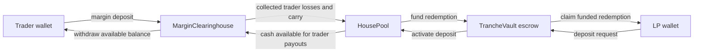

# Perps Internal Architecture Map

This guide maps contract responsibilities, custody, and the flows between trader and LP accounting. Start with
[README](README.md) for the market model; use [Accounting specification](ACCOUNTING_SPEC.md) for formulas and
[Canonical entrypoints](CANONICAL_ENTRYPOINTS.md) for integration calls.

## Contract responsibilities

| Component | Owns or coordinates | Authority boundary |
| --- | --- | --- |
| `MarginClearinghouse` | Trader USDG custody, free balance, position and order reserves, bounty ledger | Broad settlement calls trust the Engine and its settlement sidecar; Router and protection Book have narrower reservation powers. |
| `OrderRouter` | Global FIFO, per-account pending orders, commitment and execution orchestration | Validates orders and invokes the Engine; it does not price LP shares or independently pay pool cash. |
| `OrderLifecycleBook` | Permanent client-id identity, pending policy, timing, authenticated terminal outcomes | Only its bound Router registers and finalizes orders. It holds no tokens. |
| `PositionProtectionBook` | Take-profit/stop-loss state, trigger reward, latest close-attempt linkage | Calls narrow Router hooks to create orders; it cannot execute a trade or move pool cash itself. |
| `PletherOracle` | Signed basket validation, accepted live basket, historical execution prices | Only the configured Router updates the accepted current basket. Historical helpers do not authenticate arbitrary caller-supplied caches. |
| `CfdEngine` | Positions, carry, risk admission, trader claims, settlement plans | Uses the Clearinghouse and HousePool for custody; holds no trader or LP funds itself. |
| `TerminalNavBookV2` | Aggregate account-capped price curves for LP NAV | Only the bound Engine can synchronize curves, deriving them from canonical Engine/Clearinghouse state. It does not measure available cash. |
| `HousePool` | Recognized pool USDG, Senior/Junior waterfall, LP epoch clock and settlement | Engine/settlement sidecar may request trading payouts/inflows; configured vaults participate in LP settlement. |
| `TrancheVault` | LP shares, deposit escrow, redemption queues and funded claims | Chooses request epochs using the Pool clock; only the Pool activates deposits or funds redemptions. |
| `PerpsPublicLens` | Compact trader, LP and protocol views | Read-only product API. |
| `SettlementMonitorLens` | Bounded settlement-route, oracle, queue and custody diagnostics | Advisory reads; exact transaction simulation remains necessary. |
| `EmergencyPauseCoordinator` | Three fixed guardian containment actions | Can restrict new risk, LP entry and/or LP settlement. Governance must release restrictions directly. |

The contracts are non-upgradeable. Admin contracts apply the configured governance and timelock rules; a sidecar is
fixed implementation code, not an upgrade mechanism. See [Security model](SECURITY.md) for the full trust model.

## Where USDG lives

The diagram shows token custody flows. The Engine and Router authorize transitions but do not hold the balances.
Protocol fees and keeper rewards are credited to accounts **inside the Clearinghouse**, then withdrawn through its
ordinary withdrawal path. A trader claim records a liability; it does not segregate an extra USDG balance.

## Asset buckets

### Trader custody

`balanceAssets(account)` is gross Clearinghouse custody, including locked funds. It is not the withdrawable balance.
`getAccountAssetBuckets(account)` exposes the split; withdrawal also applies the Engine's carry and safety checks.

| Bucket | Purpose | Available for price losses? |
| --- | --- | --- |
| Free settlement | Unallocated trader cash; funds new reservations and action charges | Not part of the terminal price-loss collectible cap. It can pay carry. |
| PnL pledge / active position margin | Isolated position backing, exposed by `pnlPledgeAssets(account)` | Yes, after applicable carry collection. |
| Liquidation reserve | Dedicated backing for the capped liquidation charge | No; used for that charge only. |
| VPI rebate reserve | Protects an outstanding negative virtual price impact (VPI) balance | No; reserved for the matching clawback. |
| Committed order margin | Margin reserved for an opening/increase order | Not while it remains committed margin. |
| Execution/trigger bounty reserve | Rewards for opening execution or a protection trigger | No. Ordinary and protection close attempts have zero execution bounty. |

A close still creates an Active zero-amount `BountyKind.Order` record. This authenticates the order's funding identity
without locking USDG. Amounts and active reservation queues belong to the Clearinghouse; order/protection lifecycle
belongs to the Router and Books. See [Reservation ledger](ACCOUNTING_SPEC.md#reservation-ownership-and-queues).

`CfdEngine.traderClaimBalanceAssets(account)` is separate from custody. It can offset that account's price loss and count
in its price-risk equity, but cannot fund an execution bounty or other action charge. Claim payment reduces the
liability and transfers Pool USDG to the Clearinghouse; payment into an open position becomes PnL pledge.

### Pool and LP custody

| Bucket | Custody / source | Accounting treatment |
| --- | --- | --- |
| Recognized pool assets | `HousePool.totalAssets()` and accounted-asset ledger | Physical backing used by solvency, payout and LP calculations. |
| Excess USDG | Raw Pool balance above accounted assets | Excluded until governance accounts for it, or swept under the excess-asset rules. |
| Unassigned assets | Recognized Pool assets lacking an LP claimant path | Require explicit assignment; cannot silently become windfall LP ownership. |
| Pending deposit assets | USDG in a vault | Not yet pool assets or LP NAV. |
| Activated deposit shares | Shares held by a vault for a controller | Already outstanding and exposed to LP economics; claiming only delivers them. |
| Pending redemption shares | Shares escrowed in a vault | Remain outstanding and exposed to P&L until funded. |
| Funded redemption assets | USDG escrowed in a vault after shares burn | No longer Pool cash; irrevocably reserved for the funded claim. |

Do not conflate three measurements:

- **Cash:** recognized Pool USDG, subject to reserves and payout priorities.
- **Economic depth:** `max(pool assets - outstanding trader claims, 0)`, used by carry/skew/VPI calculations.
- **LP NAV:** Pool assets minus trader claims plus the signed account-capped terminal price delta at the mark.
  Distributable equity is floored at zero; any negative remainder is recorded separately as a terminal deficit.

NAV can include collectible trader losses that are not yet Pool cash. Conversely, raw excess tokens are cash at the
address but are not recognized Pool assets. [Accounting specification](ACCOUNTING_SPEC.md) defines each calculation.

## Trading flows

1. **Fund:** `depositMargin` transfers the owner's USDG into custody, then checkpoints carry if a position exists.
   `depositFor` instead credits free settlement without a carry checkpoint or position-margin allocation. Neither
   deposit automatically adds isolated position margin; the owner uses `CfdEngine.addMargin` for that.
2. **Commit:** the Router validates the request, checkpoints applicable carry, reserves opening margin/bounty or
   records a zero close bounty, and appends the order to FIFO. The lifecycle Book retains identity, bounds and timing.
3. **Execute:** the Router resolves the signed execution price, evaluates the pinned financial policy, and calls the
   Engine. The Engine updates exposure and settles through Clearinghouse/Pool authority. The Book authenticates the
   terminal receipt. A retryable failure leaves the order pending.
4. **Settle price P&L:** losses consume same-account claims and PnL pledge up to the collectible cap. Uncollectible
   price loss is reported as a write-off, not a new asset or debt. Profits become Clearinghouse cash or an unpaid
   trader claim when Pool liquidity is insufficient.
5. **Collect action charges:** carry, VPI, execution fees and frozen-close spread use their own collection rules.
   These are separate from the terminal price curve. Collected carry/spread belong to LPs; protocol fees go to treasury
   Clearinghouse margin. Terminal full-close waivers do not create future debt.

A liquidation uses a current account-adverse price, settles the price channel and dedicated liquidation reserve,
removes the position curve, and clears pending orders/protection. Its capped charge is split between keeper,
protocol treasury and LPs. A liquidated account's remaining opening bounties may be forfeited; close bounties are zero.

Risk-off cleanup is different: an invalidated opening order's remaining margin and bounties return to the same
account's free settlement, with no cleaner payment, token transfer or carry/NAV checkpoint. Liquidation performs
these refunds before evaluating the account. Account queue work is bounded by configurable `maxPendingOrders`
(default 5, governance maximum 32).

### Position protection

The Book retains `PendingOpen`, `Armed`, `Triggered` and `Latched` state separately from FIFO. A trigger pays the
separate trigger reward once and creates one full-position close attempt. If that attempt fails and the exact
protected position remains, the protection relatches; a permissionless retry creates a fresh order and clock.
A changed position ends the protection instead. Each attempt keeps its own permanent order receipt, while
`linkedOrderId` points only to the latest attempt. See [Entrypoints](CANONICAL_ENTRYPOINTS.md#traders) for management
and close-limit rules.

## LP timing and settlement

`HousePool` owns the round-hour clock. Both vault request directions use one five-minute cutoff rule:

- Before the last five minutes of an hour, target the next hour's epoch.
- At or after the cutoff, target the following epoch.
- An epoch matures when `currentEpoch >= requestId`; maturity does not guarantee funding or activation.

`TrancheVault.getRequestEpochWindow()` returns the target and next future cutoff; `PerpsPublicLens.getTrancheQueues`
relays them. The settlement monitor observes the caller-selected epoch but does not select or reorder FIFO heads.

Settlement reconciles once, funds matured Senior redemptions before Junior redemptions, rechecks deposit admission,
then activates Junior deposits before Senior deposits. If bounded Senior work leaves an eligible head, Junior work
cannot skip it. The independent LP settlement hold blocks both execution routes:

| Monitor route | Public call | Price requirement |
| --- | --- | --- |
| `CachedMark` | `HousePool.settleLpEpoch(uint256,uint256)` | No open positions, or a usable cached mark under frozen policy. |
| `AtomicOracleRefresh` | `OrderRouter.settleLpEpoch(bytes[])` | Validates the applicable Oracle policy and installs the mark in the same transaction as settlement. Live component times must meet the current-epoch floor. |

A stale frozen mark remains unusable: selecting the atomic route cannot bypass frozen policy or refresh it from live
Pyth data. A no-progress atomic settlement reverts its price updates too.

Activated deposit shares can be claimed or routed directly into redemption after the source lot's cooldown. Routing
preserves the controller and reclassifies vault-held shares; it does not transfer tokens or consume the entitlement
twice. Funded redemption claims remain available independently of later Pool entry/settlement restrictions.

## Internal implementation boundaries

| Helper | Invocation and responsibility |
| --- | --- |
| `CfdEnginePlanner` and accounting libraries | Build deterministic plans from canonical snapshots. |
| `CfdOrderPolicyEvaluator` | Stateless evaluation of current Engine state against caller-pinned financial bounds. |
| `CfdClosePreview` | Read-only pre-commit close projection, including commitment carry. It does not commit or execute. |
| `CfdEngineSettlementSidecar` | Engine-authorized close/liquidation orchestration through Engine host hooks and custody contracts. |
| `OrderRouterExecutionSidecar` | Fixed delegate implementation for order preparation, isolated execution and receipts. |
| `OrderRecoverySidecar` | Created by the execution sidecar; handles delegated expiry/invalid-order cleanup through Router host hooks. |
| `OrderRouterLiquidationBatchSidecar` | Exactly Router-bound delegate implementation for commitments, mark refresh, protection-trigger orchestration, liquidations, atomic LP settlement and oracle configuration forwarding. |
| `HousePoolRedemptionMathSidecar` | Immutable stateless pure redemption-budget calculations; no custody or settlement authority. |
| `SettlementMonitorLensSidecar` | Constructor-bound read implementation called only by its monitor facade. |

Integrators call the public Router, Engine, Book or Lens surface, not matching sidecar selectors. Router delegatecalls
retain the Router execution/event address and use authenticated host callbacks. Engine settlement-sidecar calls use
explicit authorization rather than Router delegate context. Review these boundaries separately.

The Terminal NAV Book authenticates canonical pre-transition state before synchronizing the post-transition curve.
It has no administrative curve-repair or migration path. Settlement monitoring can compare aggregate observations,
but cannot prove every account curve or authorize a repair.

For deployment bindings see [Deployment](DEPLOYMENT.md); for failure recovery see
[Emergency response](EMERGENCY_RESPONSE_GUIDE.md). When tracing a new path, identify the owner and custodian of each
bucket, the authorized mutator, and whether a transition changes custody, accounting classification, or both.
